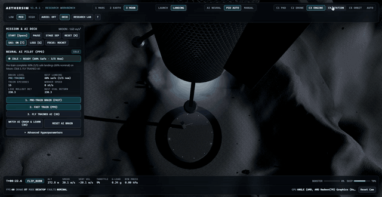
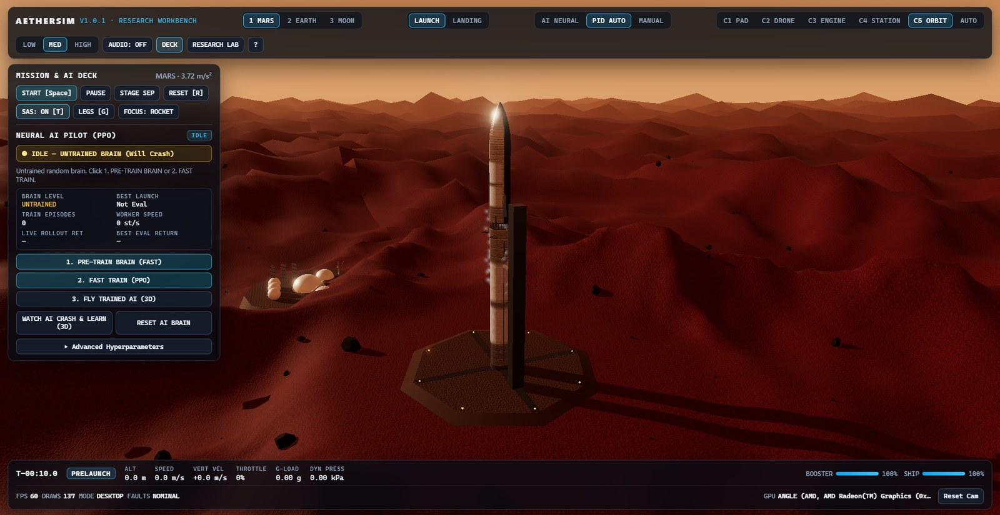
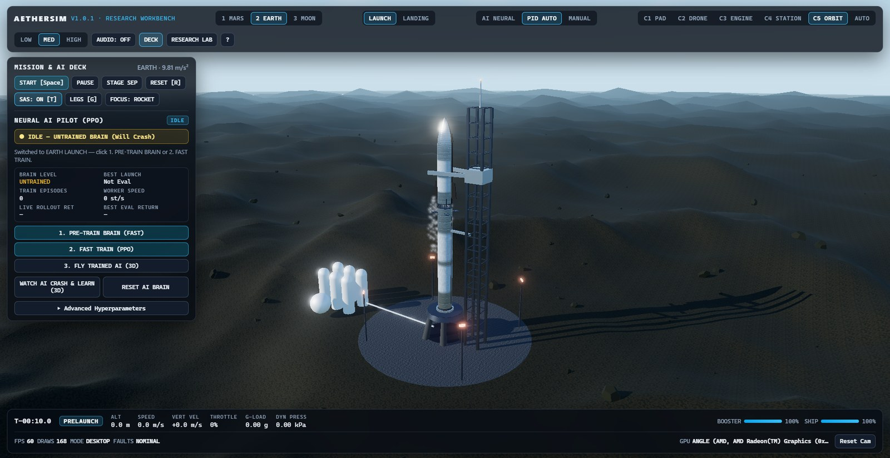
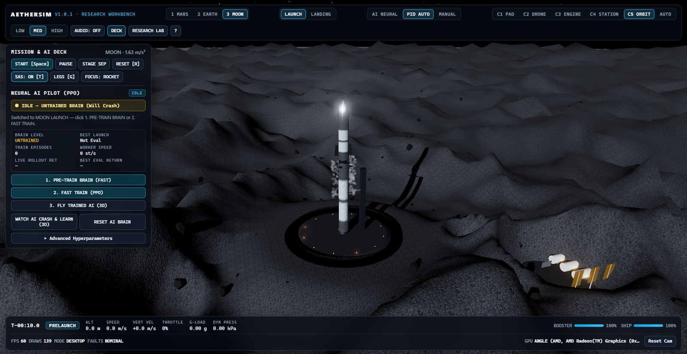
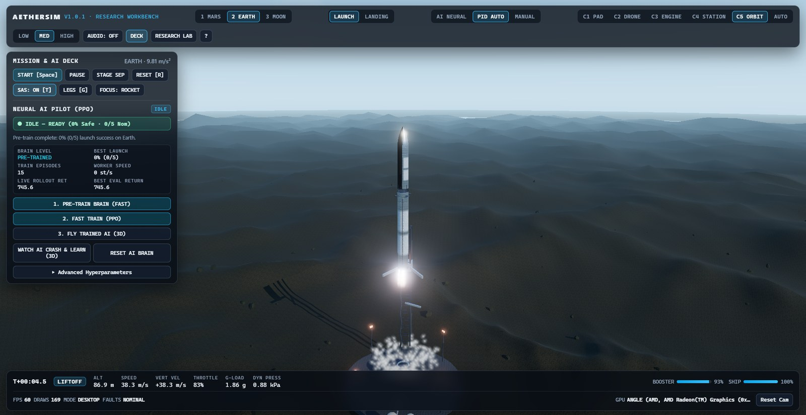
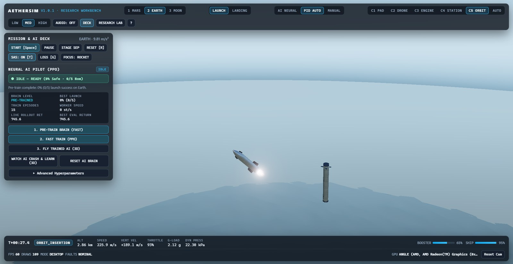
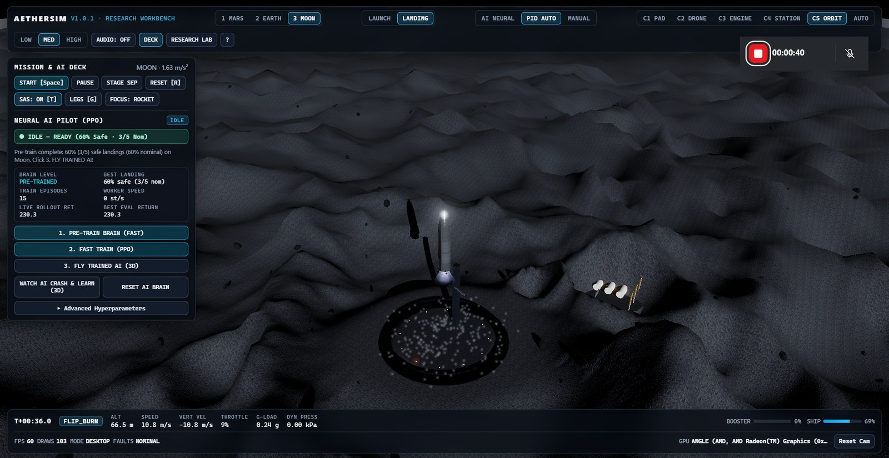

# AetherSim

**AetherSim (`v2.0.0`)** is a real-time **true `1:1` scale** 3D aerospace launch, propulsive landing, global spaceport, multi-rocket fleet, live CelesTrak SGP4 orbital explorer, neural-network RL, and flight-research desktop simulator built with **Electron**, **Three.js**, **TypeScript**, **GLSL**, **GSAP**, **satellite.js**, and **Web Audio**.

> [!NOTE]
> **Phase A Runnable Desktop Simulator (`v2.0.0`) vs. Phase B/C Ecosystem Architecture:** What runs today (`npm run desktop`, `npm run dist:win`) is the complete, verified **Phase A Desktop Simulator** covering **Milestones 1–6** (`v0.2.0` → `v2.0.0`). The repository also documents a **14-Module Aerospace Simulation Ecosystem Reference Architecture** ([`docs/ARCHITECTURE.md`](docs/ARCHITECTURE.md)) guiding future Phases B & C. Every section below explicitly separates **implemented & verified** features from **planned** ecosystem work.

---

## Visual Showcase

<p align="center">
  
</p>
<p align="center">
  <em>Moon Shackleton Crater propulsive landing showcase: aft nozzle view &rarr; final descent, lunar regolith blast cloud, landing leg deployment, and <code>NOMINAL LANDING</code> touchdown.</em>
</p>

| Mars Prelaunch Complex (`3.72 m/s²`) | Earth Starbase Orbital Launch Mount (`9.81 m/s²`) |
| :---: | :---: |
|  |  |
| *Jezero / Arcadia octagonal blast deck, servicing tower, cryogenic venting, and geodesic ISRU outpost.* | *Boca Chica `18 m` OLM, `145 m` Mechazilla tower with chopstick catch arms, umbilical, and cryo tank farm.* |

| Moon Shackleton South Pole (`1.63 m/s²`) | Earth Full-Stack Liftoff (`T+00:04.5`) |
| :---: | :---: |
|  |  |
| *Sintered lunar pad with `360°` ejecta blast berm, Artemis solar outpost on crater rim, and hard-vacuum starfield.* | *33-Raptor Mach-diamond plume, ground steam/dust cloud, retracted umbilical, and live flight HUD.* |

| Earth Hot-Stage Separation | Moon Propulsive Flip-Burn (`ALT 66.5 m`) |
| :---: | :---: |
|  |  |
| *Upper-stage vacuum burn into `ORBIT_INSERTION` above detached Super Heavy booster.* | *Shackleton final approach (`FLIP_BURN`) with lunar vacuum expansion plume and `PRE-TRAINED` scorecard.* |

---

## Implemented & Verified Capabilities (`AetherSim v2.0.0`)

### 1. Earth-First True `1:1` Real-Scale Worlds & Floating-Origin Rendering (`src/config/planets.ts`, `src/scene/`)
Three planetary worlds parameterized with NASA Planetary Fact Sheet constants at **true `1:1` physical radii** using **Float64 camera-relative floating-origin rendering** (`0 m` launchpad to `42,000+ km` GEO without WebGL precision jitter):

| World | Default Site | Surface Gravity | Surface Pressure | Atmosphere Top | `1:1` Radius / Target Orbit | Orbital Velocity (`v_circ`) |
| :--- | :--- | :--- | :--- | :--- | :--- | :--- |
| **Earth** *(Default)* | Starbase Boca Chica (`26.00° N, 97.16° W`) | `9.807 m/s²` | `1.01325 bar` | `120 km` | `6,371.0 km` / `200 km` LEO | `~7,784 m/s` |
| **Moon** | Shackleton South Pole (`89.50° S, 0.00° E`) | `1.625 m/s²` | `0.00000 bar` | `0 km` (Vacuum) | `1,737.4 km` / `100 km` LLO | `~1,634 m/s` |
| **Mars** | Jezero / Arcadia (`18.38° N, 77.58° E`) | `3.721 m/s²` | `0.00636 bar` | `90 km` | `3,389.5 km` / `200 km` LMO | `~3,446 m/s` |

- **Living Coastal & Inland Environments (`CoastalEnvironment.ts`, `oceanShader.ts`, `PbrTextureLoader.ts`, `EarthTileOverlay.ts`)**: Bundled `4K` Poly Haven CC0 PBR ground/concrete/sand/metal maps, custom GLSL ocean surf & shoreline shaders, progressive `10 m` EOX Sentinel-2 Cloudless & NASA GIBS regional satellite tile patches, and seamless transition into zero-pinch `4096×2048` NASA-derived globes (`PlanetGlobe.ts`) with animated cloud decks, night city lights, and Fresnel limb scattering.

### 2. 6 Geographically Located Earth Launch Sites (`src/config/launchSites.ts`, `LaunchComplex.ts`)
Switching sites rotates the `1:1` Earth globe ENU frame, recenters satellite tile rings, swaps terrain biomes, and rebuilds local facilities and pads:

| Spaceport | Location | Coordinates | Biome & Pad Architecture |
| :--- | :--- | :--- | :--- |
| **Starbase Boca Chica** | Texas, USA | `26.00° N, 97.16° W` | Gulf Coast dunes & ocean East · `18 m` OLM, `145 m` Mechazilla tower, Mega Bays & Highway 4 |
| **Kennedy Space Center LC-39A** | Florida, USA | `28.61° N, 80.60° W` | Atlantic barrier island · `12 m` FSS tower, crew access arm, `160 m` VAB & Crawlerway |
| **Satish Dhawan Space Centre (SHAR)** | Sriharikota, India | `13.72° N, 80.23° E` | Tropical Bay of Bengal coast · `8.5 m` umbilical tower, SVAB & coastal palms |
| **Guiana Space Centre (CSG)** | Kourou, French Guiana | `5.24° N, 52.77° W` | Equatorial `45°` NE Atlantic coast · `9 m` gantry tower & BAF integration hall |
| **Tanegashima Space Center** | Kagoshima, Japan | `30.40° N, 130.97° E` | Volcanic coastal bluff · `10 m` pad & Yoshinobu VAB overlooking Pacific surf |
| **Baikonur Cosmodrome Site 1** | Kazakhstan | `45.92° N, 63.34° E` | Arid inland steppe (`hasOcean: false`) · `6.5 m` articulated 4-arm tulip stand, rail & MIK hangar |

### 3. 4 Selectable 3D Rockets & Autonomous Booster RTLS (`src/config/vehicles.ts`, `RocketFleetBuilder.ts`, `FlightController.ts`)
All 4 procedural PBR rockets are headless-verified to reach true `1:1` `200 km` Earth LEO under `PID AUTO`:

| Launch Vehicle | Height | Propulsion & Plume Style | Recovery / Staging Profile |
| :--- | :--- | :--- | :--- |
| **Starship + Super Heavy** | `121.0 m` | `33` Booster + `6` Ship Raptors (Methalox) | `18%` RTLS fuel reserve · Hot-staging + autonomous Mechazilla catch (`BOOSTER_CAUGHT`) |
| **Falcon 9 Block 5** | `70.0 m` | `9` Merlin 1D + `1` MVac (Kerolox) | `16%` RTLS reserve · 4 folding carbon legs + autonomous RTLS touchdown (`BOOSTER_LANDED`) |
| **ISRO LVM3** | `43.5 m` | `2× S200` Solid + `L110` Core + `C25` Cryo | Independent twin `S200` strap-on separation & tumble + expendable core (`BOOSTER_EXPENDED`) |
| **NASA Saturn V** | `110.6 m` | `5× F-1` S-IC + `5× J-2` Upper + Apollo CSM/LES | Iconic black/white roll pattern + expendable `S-IC` separation (`BOOSTER_EXPENDED`) |

### 4. Explorable Satellites, ISS, Orbital Paths, Ground Tracks & Live CelesTrak SGP4 (`src/orbital/`, `OrbitalObjectManager.ts`, `OrbitalDrawer.ts`)
- **Live SGP4 Tracking (`satellite.js` `7.2.0` + `CelesTrakService.ts`)**: Queries CelesTrak's official OMM/GP JSON endpoints (`GROUP=STATIONS` and curated `CATNR` catalog numbers) with a 5-second timeout, 2-hour `localStorage` cache, rate-limited manual `Refresh Live` button, transparent `Updated (UTC)` timestamps, and seamless offline fallback (`LIVE · CELESTRAK` / `CACHED · CELESTRAK` / `SIMULATED · OFFLINE`).
- **Curated Earth Orbital Catalog (`13` objects):** **ISS (ZARYA)** (`25544`, detailed `106 m` modular 3D mesh integrated with **`F4 Station`**), **Tiangong** (`48274`), **Hubble Space Telescope** (`20580`), **Sentinel-2A** (`40697`), **NOAA-20** (`43013`), **GPS III SV01** (`43873`), **GOES-16** (`41866`), and a 6-unit **Starlink Demo Train** (`550 km`, `53.2°`), plus simulated **Moon** (**Lunar Gateway**, **LRO**) and **Mars** (**Mars Orbital Transfer Station**, **MRO**) orbiters.
- **Interactive 3D Exploration:** Closed inertial 3D orbital rings, toggleable ±1-orbit Earth surface ground tracks (`R + 1,800 m`) with nadir drop line, planet-occluded click-to-select viewport raycasting, `OrbitalDrawer` telemetry inspector (`Altitude`, `Velocity`, `Inclination`, `Period`, `Apogee/Perigee`, `Lat/Lon`, `Site Range`, `Orbit Class`), and one-click **`Inspect 3D`** orbital camera lock.

### 5. Authoritative `F1–F8` Camera Director, Studio HUD, Accessibility & Auto-Quality Guard (`CameraDirector.ts`, `src/ui/`)
- **Zero-Lag `F1–F8` Cinematography:** `F1 Pad`, `F2 Chase`, `F3 Engine`, `F4 Station` (live ISS / Lunar Gateway / Mars Station), `F5 Free`, `F6 Map` (LEO–GEO orbital overview), `F7 Booster`, and `F8 Auto` director with synchronized `Ship | Booster` tracking and instant `Re-lock`.
- **Responsive, Accessible UI:** Modular obsidian-glass HUD (`TopBar`, `MissionDrawer`, `OrbitalDrawer`, `AIPilotDrawer`, `ResearchDrawer`, `CameraDock`, `FlightHud`, `HelpModal`) with responsive breakpoints (`1024px`, `1280px`, `1360px`, `max-height: 768px`), mutually exclusive drawer slots, layered `Escape` dismissal, full ARIA states, OS + manual `Reduced Motion` parity, and an optional **`Auto Quality Guard`** (`HIGH → MED → LOW` on sustained `< 32 FPS` for `4 s`).

### 6. Pure-TypeScript Continuous PPO Neural AI & 5-Tab Research Lab (`src/ai/`, `src/research/`)
- Zero-dependency `Float32Array` Actor-Critic MLP (`14 → 64 → 64 → 3`) with Behavioral Cloning + DAgger warm-start, anti-collapse best-checkpoint protection, live 3D learning-from-crashes, background Web Worker training (`ppoWorker.ts`), and `.json` checkpoint save/load.
- **Research Lab Drawer:** Streaming `~16 Hz` telemetry plots, live neural activation visualizer, fault injection (`0–50%` thrust loss, `0–40 m/s` density-scaled wind, IMU bias/noise, TVC lag), off-thread `20/50/100`-run Monte Carlo evaluator with exact 95% Clopper-Pearson CIs, and CSV/JSON export.

---

## Verified Build, Test & Packaging Checks (`v2.0.0`)

Measured directly on this repository for `v2.0.0`:

| Check | Command | Verified Result |
| :--- | :--- | :--- |
| **Vitest Unit, Orbital, Fleet, SGP4 & RL Suite** | `npm run test` | **Passed (`12` files, `49` tests, `0` failures)** (`planets`, `noise`, `planetScale`, `earthCoastline`, `uiArchitecture`, `cameraDirector`, `launchSitesAndFleet`, `orbitalCatalog`, `orbitalMechanics`, `flightController`, `researchWorkbench`, `ppoAI`) |
| **TypeCheck & Vite Production Build** | `npm run build` | **Passed (`0` errors)**; `98` modules transformed (`dist/index.html`, `ppoWorker`, CSS & JS bundles + bundled `textures/planets/` & `textures/pbr/`) |
| **GitHub Actions CI** | `.github/workflows/ci.yml` | Runs `npm ci`, `npm run test`, and `npm run build` on `push` / `pull_request` (`main`, `develop`) |
| **Electron Dev & Prod Smoke Checks** | `node scripts/launch-desktop.mjs --smoke-test` / `--prod --smoke-test` | **`SMOKE_OK`** (`version: "2.0.0"`), `15/15` `F1–F8` camera sweep passing, `orbitalDataSource: "live_celestrak"` (`13` Earth objects), `0` errors, `0` warnings |
| **Windows Portable Desktop Build** | `npm run dist:win` | Packages standalone `release/AetherSim-2.0.0-win-x64-portable.exe` (`release/` strictly gitignored) |

---

## Multi-Planet AI (PPO) vs. PID Benchmark Summary (`v2.0.0`)

Measured directly by `npm run benchmark` ([`scripts/run-benchmark.mjs`](scripts/run-benchmark.mjs), total wall time `34,867 ms`) across `20` paired deterministic domain-randomized `landing` trials per condition (seeds `42..61`), with full data in [`docs/BENCHMARKS.md`](docs/BENCHMARKS.md), [`results/v2_benchmark.json`](results/v2_benchmark.json), and [`results/v2_benchmark.csv`](results/v2_benchmark.csv):

| Planet | Condition | Policy | Success % (95% CI) | Crash % | Mean ± Std Return | Mean TD \|vy\| | Mean Offset |
| :--- | :--- | :--- | :--- | :--- | :--- | :--- | :--- |
| **Mars** | Nominal | `untrained_ppo` | `0.0%` (`0.0–16.8%`) | `0.0%` | `-2336.7 ± 100.5` | N/A | N/A |
| **Mars** | Nominal | `ppo_scratch` (`8,192` steps) | `0.0%` (`0.0–16.8%`) | `0.0%` | `-1035.0 ± 547.2` | N/A | N/A |
| **Mars** | Nominal | `ppo_trained` (BC + `8,192` PPO) | **`70.0%`** (`45.7–88.1%`) | `0.0%` | `+268.4 ± 80.9` | `4.08 m/s` | `1.3 m` |
| **Mars** | Nominal | `pid_baseline` | **`100.0%`** (`83.2–100.0%`) | `0.0%` | **`+348.6 ± 11.9`** | `1.40 m/s` | `0.1 m` |
| **Earth** | Nominal | `untrained_ppo` | `0.0%` (`0.0–16.8%`) | `0.0%` | `-1553.2 ± 588.9` | N/A | N/A |
| **Earth** | Nominal | `ppo_scratch` (`8,192` steps) | `0.0%` (`0.0–16.8%`) | `0.0%` | `-2262.2 ± 293.6` | N/A | N/A |
| **Earth** | Nominal | `ppo_trained` (BC + `8,192` PPO) | **`100.0%`** (`83.2–100.0%`) | `0.0%` | **`+336.7 ± 13.5`** | `2.48 m/s` | `0.9 m` |
| **Earth** | Nominal | `pid_baseline` | **`100.0%`** (`83.2–100.0%`) | `0.0%` | **`+356.8 ± 10.5`** | `1.40 m/s` | `0.0 m` |
| **Moon** | Nominal | `untrained_ppo` | `0.0%` (`0.0–16.8%`) | `0.0%` | `-2355.2 ± 134.2` | N/A | N/A |
| **Moon** | Nominal | `ppo_scratch` (`8,192` steps) | `0.0%` (`0.0–16.8%`) | `0.0%` | `-572.4 ± 188.3` | N/A | N/A |
| **Moon** | Nominal | `ppo_trained` (BC + `8,192` PPO) | **`75.0%`** (`50.9–91.3%`) | `25.0%` | `+228.3 ± 156.8` | `1.33 m/s` | `4.0 m` |
| **Moon** | Nominal | `pid_baseline` | **`100.0%`** (`83.2–100.0%`) | `0.0%` | **`+330.5 ± 13.5`** | `1.40 m/s` | `3.0 m` |

> Under the **Fault Stress Test** (`15%` thrust loss + `15 m/s` crosswind on Mars/Earth; `15%` thrust loss in Moon vacuum), `pid_baseline` achieved `100.0%` nominal landing on Mars (`+341.2`) and Moon (`+322.0`) with `0.0%` crash on Earth (`+146.5`, `1.93 m/s` tdVy, `11.2 m` wind drift), while `ppo_trained` achieved `65.0%` nominal landing in Moon vacuum (`+192.8`, `1.81 m/s` tdVy).

---

## Measured Desktop GPU & FPS Profile (`npm run profile:desktop`, `v2.0.0`)

Measured directly inside the built `v2.0.0` Electron app across `3,000 ms` rAF sampling windows per `(Planet × Quality)` configuration ([`docs/PERFORMANCE_REPORT.md`](docs/PERFORMANCE_REPORT.md), [`results/v2_performance_profile.json`](results/v2_performance_profile.json)):

- **Test Hardware Scope:** `Windows_NT 10.0.26300 (x64)` · `AMD Ryzen 5 5600H` (`12` logical cores) · `7.3 GB` RAM · `ANGLE (AMD, AMD Radeon(TM) Graphics Direct3D11 vs_5_0 ps_5_0, D3D11)` · `1426×779` viewport. *(Integrated laptop GPU measurement; frame rates vary with host GPU class and power state—use the built-in `LOW`/`MED`/`HIGH` presets or Settings → `Auto Quality Guard`.)*

| Planet | `LOW` FPS (p50 / p95 ms) | `MED` FPS (p50 / p95 ms) | `HIGH` FPS (p50 / p95 ms) | Draw Calls (`LOW` → `MED/HIGH`) | Triangles (`LOW` → `MED` → `HIGH`) | JS Heap |
| :--- | :--- | :--- | :--- | :--- | :--- | :--- |
| **Mars** | **58.9** (`16.70 / 17.10`) | **53.5** (`16.70 / 33.20`) | **31.7** (`33.30 / 50.00`) | `106` → `120` | `85,220` → `111,474` → `147,954` | `33.5 MB` |
| **Earth** | **45.1** (`16.70 / 50.80`) | **25.9** (`33.30 / 99.60`) | **23.3** (`49.80 / 50.60`) | `128` → `142` | `96,330` → `129,190` → `165,670` | `33.5 MB` |
| **Moon** | **53.1** (`16.70 / 17.00`) | **42.2** (`16.80 / 33.50`) | **35.3** (`33.20 / 33.60`) | `109` → `123` | `83,768` → `110,022` → `146,502` | `33.5 MB` |

---

## Quick Start & Commands

### Prerequisites
- **Node.js** `>= 20` and **npm**
- Windows/macOS/Linux desktop with WebGL-capable GPU drivers (Electron packaging command `dist:win` targets Windows x64)

### Commands
```powershell
npm install
```

| Command | Purpose |
| :--- | :--- |
| `npm run desktop` | Launch Vite dev server (`127.0.0.1:5173`) + Electron desktop window |
| `npm run desktop:prod` | Build `dist/` and launch production Electron desktop app |
| `npm run dev` | Run browser-only Vite dev server |
| `npm run test` | Run headless Vitest suite (`12` suites / `49` tests: physics, sites, fleet, SGP4, PPO, UI) |
| `npm run build` | TypeScript strict check (`tsc --noEmit`) + Vite production bundle |
| `npm run benchmark` | Run deterministic 3-planet PPO vs. PID benchmark harness (`results/v2_*` & `docs/BENCHMARKS.md`) |
| `npm run profile:desktop` | Profile live Electron GPU/FPS frame times across 9 configs (`docs/PERFORMANCE_REPORT.md`) |
| `npm run generate:icon` | Regenerate `build/icon.png` (`512×512`) and multi-size `build/icon.ico` |
| `npm run dist:win` | Build standalone Windows x64 portable `.exe` in `release/` (`electron-builder`) |
| `npm run dist:win:dir` | Build unpacked Windows x64 Electron directory in `release/win-unpacked/` |

### Flight, Camera & Explorer Controls

| Key / Control | Action |
| :--- | :--- |
| `1` / `2` / `3` | Switch world (**Earth** / **Moon** / **Mars**) |
| `Space` | Launch / start mission, or trigger Stage Separation during ascent |
| `R` | Reset mission & re-lock camera onto active vehicle |
| `F1` – `F8` | Cameras (`Pad`, `Chase`, `Engine`, `Station / ISS`, `Free`, `Map`, `Booster`, `Auto`) |
| `Click Satellite` | Select any visible satellite in space / `F6 Map` and open the `OrbitalDrawer` Inspector |
| `[` / `]` | Step Physics Time Warp (`1x` / `2x` / `5x` / `10x` / `25x` / `50x`) |
| `W/Shift` & `S/Ctrl`, `Z/X` | Manual throttle up / down (`Z` = `100%`, `X` = `0%`) |
| `Arrows` or `I/J/K/L`, `Q/E` | Manual Pitch/Yaw TVC & Roll RCS attitude control |
| `G` / `T` / `M` / `V` / `Esc` | Toggle Landing Legs / SAS Assist / Audio Mute / Auto Director / Close Active Modal or Drawer |

---

## Data & Asset Attributions

- **4K Global Planetary Satellite Maps (`public/textures/planets/`):** [Solar System Scope](https://www.solarsystemscope.com/textures/) derived from NASA Visible Earth / Blue Marble, Viking-MOLA, and LROC WAC datasets — **CC-BY 4.0** (see [`public/textures/planets/ATTRIBUTION.md`](public/textures/planets/ATTRIBUTION.md)).
- **Photoscanned 4K PBR Materials (`public/textures/pbr/`):** [Poly Haven](https://polyhaven.com/textures) (`asphalt_02`, `concrete_floor_02`, `coast_sand_01`, `coast_sand_rocks_02`, `corrugated_iron_02`) — **CC0 1.0 Universal Public Domain**.
- **Regional High-Resolution Earth Satellite Tiles:** [EOX IT Services GmbH — Sentinel-2 Cloudless](https://s2maps.eu/) (Copernicus Sentinel data, CC BY-NC-SA 4.0) and [NASA GIBS](https://earthdata.nasa.gov/eosdis/science-system-description/eosdis-components/gibs) (Public Domain), with automatic offline fallback.
- **Live Orbital Ephemerides & SGP4 Propagation:** [CelesTrak](https://celestrak.org/) GP/OMM orbital element catalog propagated via [`satellite.js`](https://github.com/shashwatak/satellite-js) (`v7.2.0`, MIT License), respecting 2-hour local caching and offline simulated snapshots.

---

## Preserved Legacy 2D Python RL Baseline (`archive/legacy-rl-2d/`)

Milestone 0 (`v0.1.0`) remains preserved under [`archive/legacy-rl-2d/`](archive/legacy-rl-2d/) using Python, Farama Gymnasium (`LunarLander-v3`, Box2D), and Stable-Baselines3 PPO. Deterministic `100`-episode unshaped evaluations (seeds `42–141`, [`benchmark_summary.json`](archive/legacy-rl-2d/results/benchmark_summary.json), [`planet_benchmark_summary.json`](archive/legacy-rl-2d/results/planet_benchmark_summary.json)) measured `-193.03` (random) → `+118.82` (`ppo_1m_shaped`, `31%` solved) and motivated AetherSim's native multi-planet 3D PPO trainer.

---

## Limitations & Simulation Fidelity Disclaimer

AetherSim `v2.0.0` is a **real-time interactive aerospace visualization, orbital exploration, and RL research simulator (Phase A)**, **not a flight-qualified verification tool**:
- **Simplified Real-Time Physics & Visual LOD**: Launch trajectories use true `1:1` spherical 2-body central-body gravity ($\mu = g_0 R^2$) with simplified parametric aerodynamics and rigid-body attitude dynamics; Earth satellites propagate via SGP4 (`satellite.js`), while Moon/Mars orbiters use analytical Keplerian elements clearly badged `SIMULATED`. Propellant slosh, flexible-body modes, J2–Jn / N-body perturbations for rockets, and ablative TPS heating are deferred to Phase B.
- **Real-Time Shader Approximations**: GLSL Mach-diamond plumes, Schlieren shimmer, ocean surf, and Rayleigh/Mie skies are physically inspired real-time approximations—not Navier-Stokes CFD, DSMC rarefied gas dynamics, or thermal FEA.
- **No Flight Certification**: This software has **not** undergone DO-178C, NPR 7150.2, NASA-STD-7009 VVUQ, HIL qualification, or AFSS range-safety certification and **must never be used for operational flight decisions**.

---

## Documentation & Ecosystem Roadmap

| Document | Contents |
| :--- | :--- |
| [`docs/ARCHITECTURE.md`](docs/ARCHITECTURE.md) | 3 execution regimes, 14-module aerospace ecosystem architecture, Phase A `v2.0.0` vs. Phase B/C boundaries |
| [`docs/BENCHMARKS.md`](docs/BENCHMARKS.md) | Reproducible `v2.0.0` multi-planet PPO vs. PID & fault stress-test benchmark report (`results/v2_benchmark.json`) |
| [`docs/PERFORMANCE_REPORT.md`](docs/PERFORMANCE_REPORT.md) | Measured `v2.0.0` Electron GPU/FPS profiling report across Mars/Earth/Moon × `LOW/MED/HIGH` (`results/v2_performance_profile.json`) |
| [`docs/MILESTONES.md`](docs/MILESTONES.md) | Git branching strategy and complete Milestones 0–6 + Phase B/C tracker |
| [`docs/VALIDATION_AND_SAFETY.md`](docs/VALIDATION_AND_SAFETY.md) | VVUQ framework, PINN/RL OOD bounds, Clopper-Pearson & Wilks Monte Carlo criteria, safety gates |
| [`CHANGELOG.md`](CHANGELOG.md) | Versioned release history (`v0.1.0` → `v2.0.0`) |

### Roadmap Overview

| Phase / Milestone | Version | Status | Scope Summary |
| :--- | :--- | :--- | :--- |
| **Milestone 0** | `v0.1.0` | **Complete (Archived)** | 2D Python PPO Rocket Lander (`archive/legacy-rl-2d/`) |
| **Milestone 1** | `v0.3.0` | **Complete & Verified** | 3D Electron/Three.js Mars/Earth/Moon worlds, Starship stack, pads/stations, 6-DOF flight, RUD FX, GLSL plumes |
| **Milestone 2** | `v0.4.0` | **Complete & Verified** | Pure-TS `Float32Array` Continuous PPO Neural Network, live 3D learning-from-crashes & Web Worker trainer |
| **Milestone 3** | `v0.5.0` | **Complete & Verified** | Research Workbench (live plots, NN visualizer, fault injection, Monte Carlo, CSV/JSON), GSAP cameras, Web Audio |
| **Milestone 4** | `v1.0.0` | **Complete & Verified** | Multi-planet benchmark harness, Electron GPU/FPS profiler, GitHub Actions CI, Windows `.exe` packaging |
| **Hotfix / Docs** | `v1.0.1` | **Complete & Verified** | PPO anti-collapse best-checkpoint guard, session worker sync, `padDeckY` parity, AI status HUD & visual showcase |
| **Milestone 5** | `v1.1.0` | **Complete & Verified** | Planet-scale 3D globes, spherical orbital insertion autopilot, 3D orbital path visualizer & `C6 MAP` view |
| **Milestone 6** | `v2.0.0` | **Complete & Verified** | True `1:1` real-scale worlds, studio UI/accessibility, 6 global Earth launch sites, 4 rockets, live CelesTrak SGP4 ISS & satellites, `F1–F8` camera overhaul & Auto Quality Guard |
| **Phases B & C** | Post-`v2.0` | **Planned Ecosystem** | FMI/FMU & DDS co-simulation, full N-body astrodynamics, offline CFD/FEA surrogates, AFSS, ECLSS, RTOS/HIL FlatSat |
