<div align="center">

# AetherSim

**Real-Time True `1:1` Scale 3D Aerospace Launch, Autonomous RTLS, Live CelesTrak SGP4 Orbital Explorer & Neural-Network RL Desktop Simulator**

[](CHANGELOG.md)
[](.github/workflows/ci.yml)
[](package.json)
[](package.json)
[](electron/main.cjs)
[](src/ai/PPOTrainer.ts)
[](src/config/planets.ts)

<br />

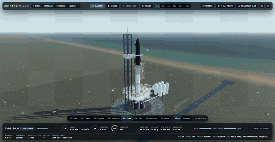

*Full `1:1` Earth orbital flight from Starbase Boca Chica: 33-Raptor liftoff &rarr; autonomous Super Heavy Mechazilla chopstick catch (`0.0 m` offset) &rarr; Starship cruising in stable `202.7 km` LEO (`7,778 m/s`, `e = 0.001`).*

<!--
  Optional: Drag-and-drop full 1080p MP4 showcase clips from local `videos/`
  (`videos/v2_launch_rtls_orbit.mp4`, `videos/v2_global_tour_iss.mp4`) directly
  into GitHub's web README editor to embed native GitHub video players here.
-->

</div>

---

## Why AetherSim (`v2.0.0`)

**AetherSim** bridges photorealistic real-time 3D spaceflight, live orbital situational awareness, and hands-on reinforcement learning inside a single native Electron desktop application—running at **`56.8–59.8 FPS`** (`MED`, integrated Radeon GPU) across **Earth, Moon, and Mars** with **zero external RL runtime dependencies**.

| Pillar | What Runs Today in `v2.0.0` |
| :--- | :--- |
| **True `1:1` Real-Scale Worlds** | Full planetary radii (**Earth `6,371 km`**, **Mars `3,389.5 km`**, **Moon `1,737.4 km`**) powered by **Float64 camera-relative floating-origin rendering**, `120 km` Rayleigh/Mie atmosphere, 4K Poly Haven PBR terrain, `10 m` EOX Sentinel-2 / NASA GIBS tiles, and 4K NASA-derived globes. |
| **6 Global Earth Spaceports** | Launch from **Starbase Boca Chica**, **KSC LC-39A**, **Satish Dhawan SHAR (India)**, **CSG Kourou**, **Tanegashima**, or **Baikonur Site 1**—rotating the `1:1` Earth globe ENU frame, biomes, coastal ocean shaders, and site-authentic pads & integration halls. |
| **4 Multi-Stage Rockets & RTLS** | Fly **Starship + Super Heavy** (Mechazilla catch), **Falcon 9 Block 5** (folding carbon legs RTLS), **ISRO LVM3** (twin S200 solid strap-on separation + L110 + C25), and **NASA Saturn V** (S-IC + S-II/IVB + Apollo CSM/LES) to true `200 km` LEO. |
| **Live CelesTrak SGP4 & ISS** | Track **13 real & curated Earth objects** led by the **ISS (ZARYA)**, **Tiangong**, **Hubble**, **Sentinel-2A**, **NOAA-20**, **GPS III**, **GOES-16**, and a **Starlink train** via `satellite.js` SGP4 with honest `LIVE` / `CACHED` / `SIMULATED` badges, 3D orbit rings, ±1-orbit ground tracks, and 3D inspection. |
| **Pure-TS PPO AI & Research Lab** | Train a zero-dependency `Float32Array` Continuous Actor-Critic MLP (`14 → 64 → 64 → 3`) live in 3D or off-thread in a Web Worker (`41,000+ steps/s`) with BC+DAgger warm-start, anti-collapse protection, fault injection, streaming plots, NN visualizer, and 95% CI Monte Carlo sweeps. |
| **Native Electron Desktop App** | Sandboxed Chromium/WebGL2 shell with `259 ms` startup, zero-lag `F1–F8` camera director, procedural Web Audio synthesis, responsive ARIA-compliant HUD, optional `Auto Quality Guard`, and standalone Windows x64 `.exe` packaging. |

> [!NOTE]
> **Phase A Runnable Desktop Simulator (`v2.0.0`) vs. Planned Phase B/C Ecosystem:** Everything showcased below is implemented, tested (`52/52` Vitest checks), and runnable today (`npm run desktop` / `npm run dist:win`). Long-horizon ecosystem extensions (FMI/FMU, DDS, N-body, offline CFD/FEA, HIL FlatSat) are documented separately as **Planned** in [`docs/ARCHITECTURE.md`](docs/ARCHITECTURE.md).

---

## Visual Showcase

### 1. Launch to Orbit & Autonomous Mechazilla Catch

| Earth Starbase Boca Chica (`26.00° N, 97.16° W`) | Full-Stack Liftoff Clearing Mechazilla (`T+00:08.0`) |
| :---: | :---: |
| 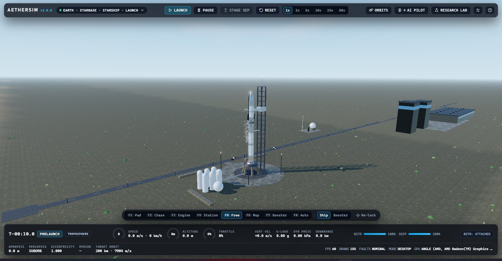 | 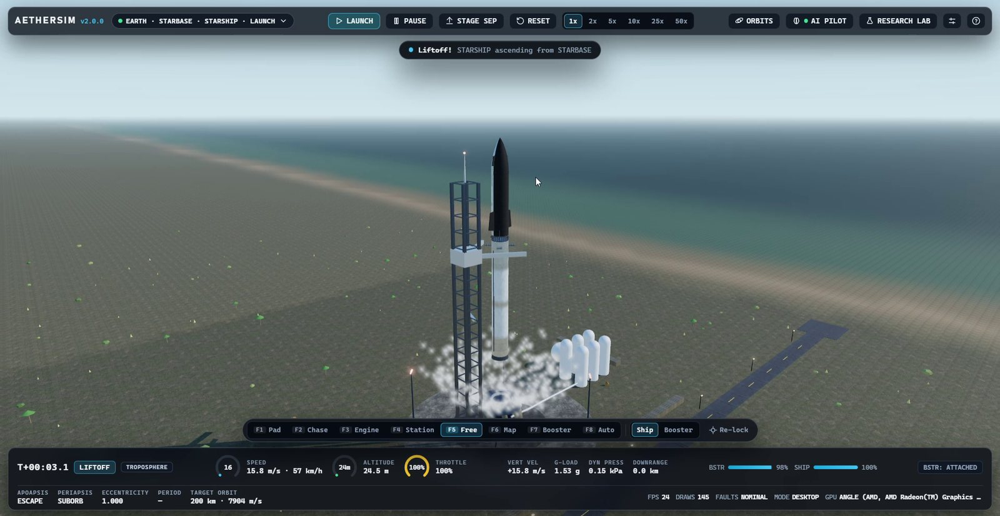 |
| *`18 m` Orbital Launch Mount, `145 m` Mechazilla catch tower, cryo tank farm, Highway 4, Mega Bays, and Gulf Coast shoreline.* | *33-Raptor ignition, steam deluge cloud, retracted umbilical arm, and real-time webcast telemetry gauges.* |

| Autonomous Super Heavy Mechazilla Catch (`0.0 m`) | Starship in True `1:1` `202.7 km` Earth LEO (`7,778 m/s`) |
| :---: | :---: |
| 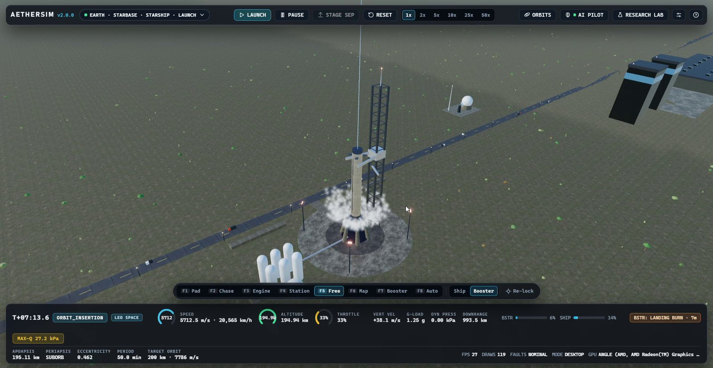 | 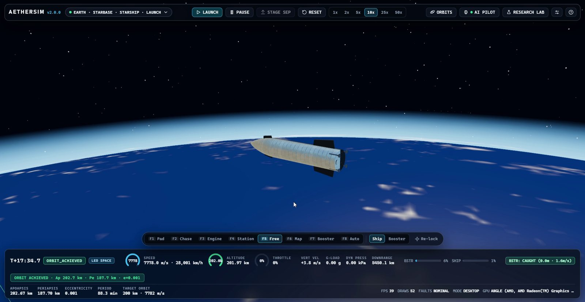 |
| *Detached Super Heavy executes flip, boostback, grid-fin descent, and vertical Raptor landing burn into the chopsticks while Ship ascends.* | *`ORBIT ACHIEVED` (`Ap 202.7 km · Pe 187.7 km · e = 0.001`) above Earth's glowing curved atmosphere (`BSTR: CAUGHT 0.0 m · 1.6 m/s`).* |

---

### 2. Global Earth Launch Sites & Multi-Rocket Fleet

<p align="center">
  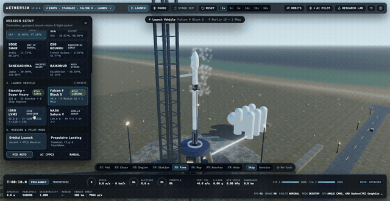
</p>
<p align="center">
  <em>Switching across Falcon 9, ISRO LVM3, and Saturn V across Satish Dhawan SHAR and Baikonur Cosmodrome &rarr; zooming out to the 4K Earth globe with live CelesTrak rings and 3D ISS inspection.</em>
</p>

| ISRO LVM3 (`2× S200 + L110 + C25`) & Fleet Selector | Baikonur Cosmodrome Site 1 (`45.92° N, 63.34° E`) |
| :---: | :---: |
| 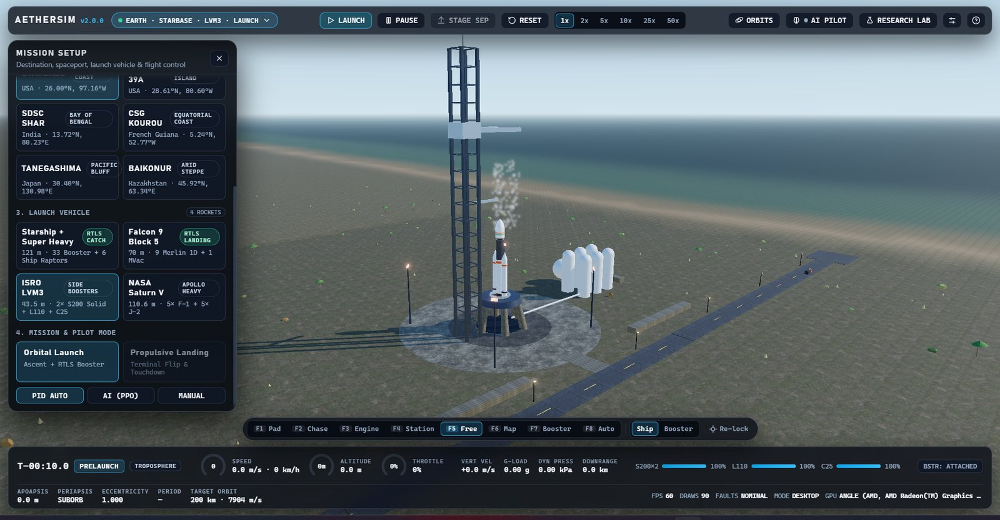 | 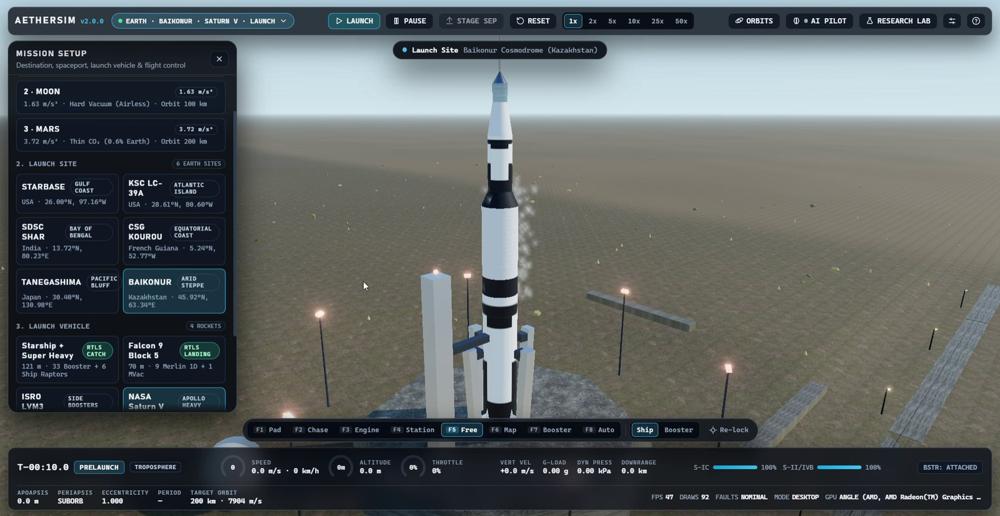 |
| *Selectable 4-rocket fleet and 6 global launch sites in the Mission Setup drawer, showing twin strap-on S200 solid boosters.* | *Inland Kazakh arid steppe (`hasOcean: false`), articulated 4-arm tulip launch stand, railway corridor, and NASA Saturn V.* |

---

### 3. Live CelesTrak SGP4 Satellites, ISS & Orbital Ground Tracks

| International Space Station (`ISS`, NORAD `25544`) | Live CelesTrak Orbital Inspector & 6 Spaceports |
| :---: | :---: |
| 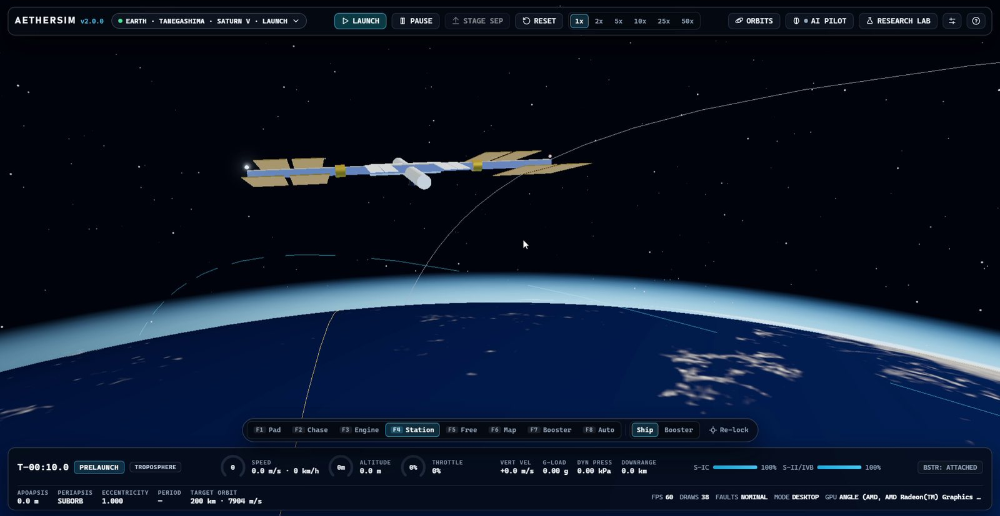 | 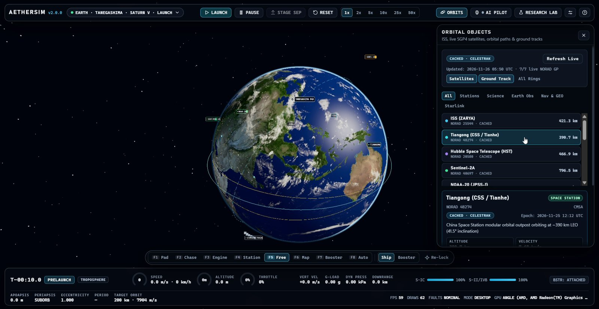 |
| *Detailed `106 m` modular 3D ISS (`F4 Station` / `Inspect 3D`) with golden solar wings and Earthshine rim illumination over Earth's blue limb.* | *Real-time `satellite.js` SGP4 propagation with `CACHED / LIVE CELESTRAK` badges, UTC timestamps, ±1-orbit ground tracks, and site directory.* |

| Full 4K Earth Globe & Closed `202.7 km` LEO Ring | Continuous PPO AI Pilot & 5-Tab Research Workbench |
| :---: | :---: |
| 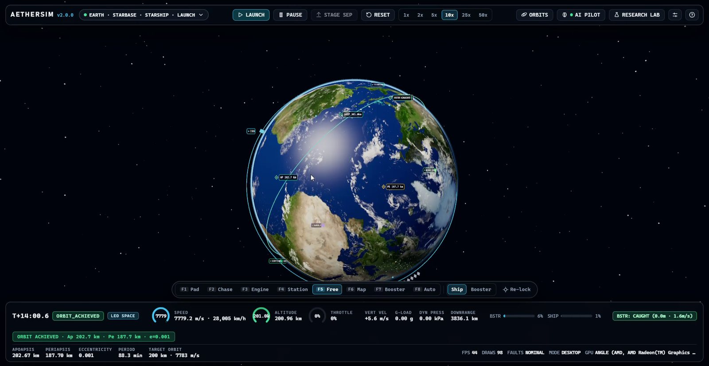 | 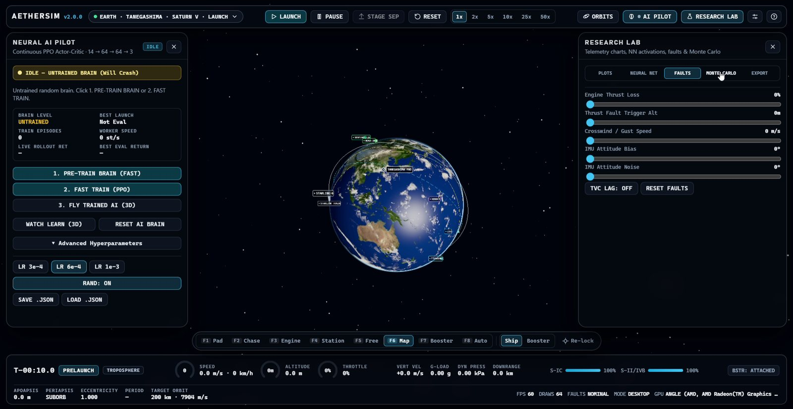 |
| *`F6 Map` view displaying the 4K NASA Blue Marble globe, closed emerald spacecraft LEO ring, ISS cyan orbit, and amber surface ground track.* | *Side-by-side Continuous PPO Actor-Critic deck (`14 → 64 → 64 → 3`) and Research Lab (streaming plots, NN activations, fault injection, Monte Carlo, export).* |

---

### 4. Moon & Mars `1:1` Worlds & Orbital Explorers

<p align="center">
  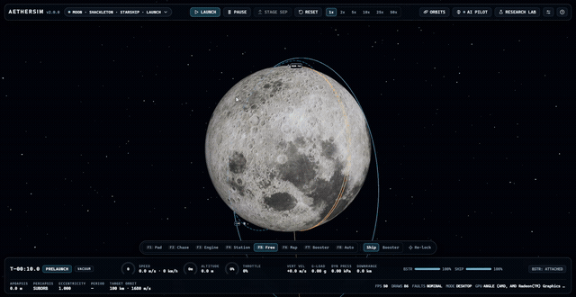
</p>
<p align="center">
  <em>Seamless `1:1` planetary globes: NASA LRO Moon with Lunar Gateway NRHO &amp; LRO polar orbits &rarr; 4K Mars with Mars Orbital Transfer Station &amp; MRO orbits.</em>
</p>

| Moon Shackleton South Pole (`1.63 m/s²`, Hard Vacuum) | 4K Moon Globe (`Lunar Gateway` & `LRO` Orbits) |
| :---: | :---: |
| 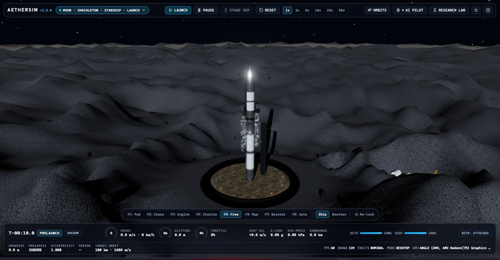 | 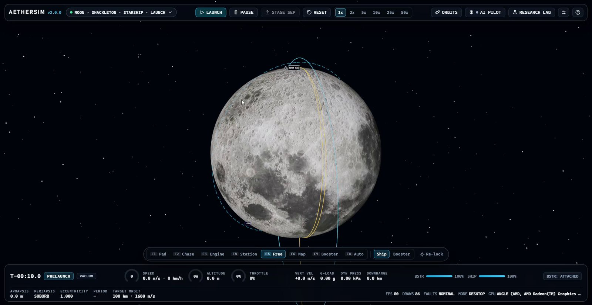 |
| *Sintered lunar pad, `360°` regolith ejecta berm, Artemis solar outpost on crater rim, and pitch-black vacuum starfield.* | *`1,737.4 km` 4K LRO lunar sphere with elliptical polar Lunar Gateway halo orbit and `100 km` LRO mapping orbit.* |

| Mars Jezero Crater (`3.72 m/s²`, Thin CO₂ Sky) | 4K Mars Globe (`Mars Station` & `MRO` Orbits) |
| :---: | :---: |
| 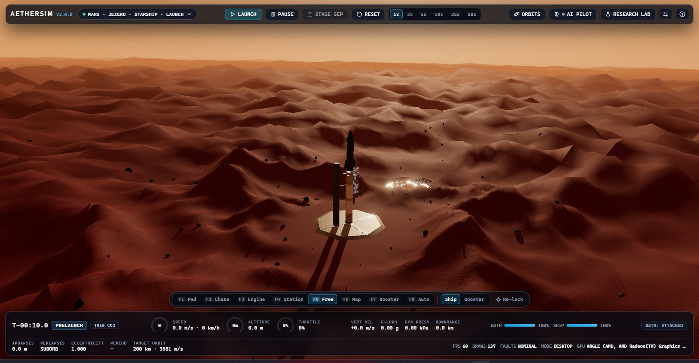 | 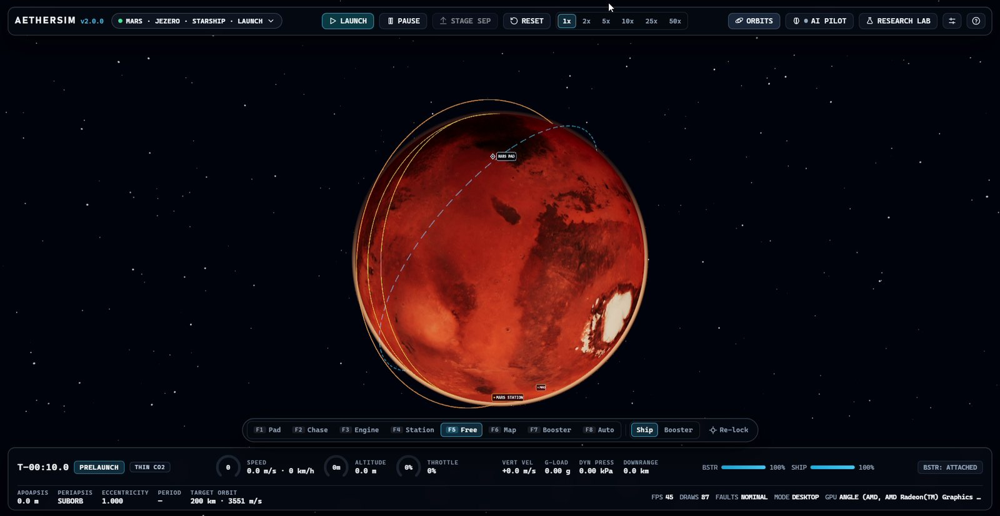 |
| *Butterscotch ochre Rayleigh/Mie atmosphere, cratered Jezero dunes, octagonal blast pad, and glowing geodesic ISRU Sabatier habitat.* | *`3,389.5 km` 4K Mars sphere with `320 km` Mars Orbital Transfer Station ring and `300 km` near-polar MRO HiRISE orbit.* |

---

## True `1:1` Planetary & Orbital Physics

All three worlds use verified NASA Planetary Fact Sheet physical constants at **true `1:1` scale**, coupled with **Float64 camera-relative floating-origin rendering** (`renderOrigin` anchored to the active spacecraft, station, or planet center) so WebGL stays jitter-free from `0 m` pad inspection out to `35,786 km` GEO:

| World | Default Site | Gravity ($g_0$) | Surface Pressure | Atmosphere Top | True `1:1` Radius / Target Orbit | Circular Velocity ($v_{\text{circ}}$) |
| :--- | :--- | :---: | :---: | :---: | :---: | :---: |
| **Earth** *(Default)* | Starbase Boca Chica (`26.00° N, 97.16° W`) | `9.807 m/s²` | `1.01325 bar` | `120 km` | `6,371.0 km` / `200 km` LEO | `~7,784 m/s` |
| **Moon** | Shackleton South Pole (`89.50° S, 0.00° E`) | `1.625 m/s²` | `0.00000 bar` | `0 km` (Vacuum) | `1,737.4 km` / `100 km` LLO | `~1,634 m/s` |
| **Mars** | Jezero / Arcadia (`18.38° N, 77.58° E`) | `3.721 m/s²` | `0.00636 bar` | `90 km` | `3,389.5 km` / `200 km` LMO | `~3,446 m/s` |

- **Velocity-Verlet Central-Body Integration (`FlightController.ts`, `OrbitalMechanics.ts`):** Spherical gravity ($\mu = g_0 R^2$), Tsiolkovsky variable-mass propellant burn, realistic atmospheric `Max-Q` peak detection (`< 35 km`), `1x | 2x | 5x | 10x | 25x | 50x` deterministic Time Warp, and closed-loop gravity-turn &rarr; hot-staging &rarr; coast-to-apoapsis &rarr; circularization guidance.
- **Seamless Ground-to-Space Blending (`TerrainSystem.ts`, `EarthTileOverlay.ts`, `PlanetGlobe.ts`):** Dual-scale `37°`-rotated UV anti-tiling + world-space FBM breakup, smooth `0.42–0.95 R` radial skirt feathering completing fade-out strictly below `10 km` (Earth) and `18 km` (Moon/Mars), progressive `10 m` EOX Sentinel-2 Cloudless & NASA GIBS tile patches, and zero-pinch `4096×2048` icosahedral globes with screen-space spaceport pins (`>= 450 km`).

---

## Global Launch Sites & Selectable Rocket Fleet

### 6 Geographically Located Earth Spaceports (`src/config/launchSites.ts`)

| Spaceport | Location | Coordinates | Biome & Pad Infrastructure |
| :--- | :--- | :---: | :--- |
| **Starbase Boca Chica** | Texas, USA | `26.00° N, 97.16° W` | Gulf Coast dunes & animated ocean East · `18 m` OLM, `145 m` Mechazilla catch tower, Mega Bays & Highway 4 |
| **Kennedy Space Center LC-39A** | Florida, USA | `28.61° N, 80.60° W` | Atlantic barrier island · `12 m` FSS tower, crew access swing arm, `160 m` VAB & Crawlerway |
| **Satish Dhawan Space Centre (SHAR)** | Sriharikota, India | `13.72° N, 80.23° E` | Tropical Bay of Bengal coast · `8.5 m` umbilical tower, SVAB & dense coastal palms |
| **Guiana Space Centre (CSG)** | Kourou, French Guiana | `5.24° N, 52.77° W` | Equatorial `45°` NE Atlantic coastline · `9 m` gantry tower & BAF integration hall |
| **Tanegashima Space Center** | Kagoshima, Japan | `30.40° N, 130.97° E` | Volcanic green coastal bluff · `10 m` pad & Yoshinobu VAB overlooking Pacific surf |
| **Baikonur Cosmodrome Site 1** | Kazakhstan | `45.92° N, 63.34° E` | Arid inland steppe (`hasOcean: false`) · `6.5 m` articulated 4-arm tulip stand, railway & MIK hangar |

### 4 Selectable Multi-Stage Launch Vehicles (`src/config/vehicles.ts`, `RocketFleetBuilder.ts`)

All 4 procedural PBR launch vehicles are headless-verified in Vitest to achieve stable `1:1` `200 km` Earth LEO:

| Launch Vehicle | Height | Propulsion & Plume Style | Staging & Recovery Profile |
| :--- | :---: | :--- | :--- |
| **Starship + Super Heavy** | `121.0 m` | `33` Booster + `6` Ship Raptors (Methalox) | `18%` RTLS fuel reserve · Hot-staging + autonomous Mechazilla catch (`BOOSTER_CAUGHT`) |
| **Falcon 9 Block 5** | `70.0 m` | `9` Merlin 1D + `1` MVac (Kerolox) | `16%` RTLS reserve · 4 folding carbon landing legs + autonomous RTLS landing (`BOOSTER_LANDED`) |
| **ISRO LVM3** | `43.5 m` | `2× S200` Solid + `L110` Core + `C25` Cryo | Independent twin `S200` strap-on separation & tumble + expendable core (`BOOSTER_EXPENDED`) |
| **NASA Saturn V** | `110.6 m` | `5× F-1` S-IC + `5× J-2` S-II/IVB + CSM/LES | Iconic black/white Apollo roll pattern + expendable `S-IC` separation (`BOOSTER_EXPENDED`) |

---

## Live Orbital Tracking & Neural AI Research Workbench

### Live CelesTrak SGP4 Explorer (`src/orbital/`, `OrbitalObjectManager.ts`)
- Propagates real **CelesTrak OMM/GP** orbital elements using **`satellite.js` (`v7.2.0`)** with a 5-second fetch timeout, 2-hour `localStorage` cache, rate-limited manual `Refresh Live`, transparent `Updated (UTC)` timestamps, and automatic offline fallback (`LIVE · CELESTRAK` / `CACHED · CELESTRAK` / `SIMULATED · OFFLINE`).
- **Curated Earth Catalog (`13` objects):** **ISS (ZARYA)** (`25544`), **Tiangong** (`48274`), **Hubble Space Telescope** (`20580`), **Sentinel-2A** (`40697`), **NOAA-20** (`43013`), **GPS III SV01** (`43873`), **GOES-16** (`41866`), and a 6-spacecraft **Starlink Demo Train** (`550 km`, `53.2°`)—plus simulated **Moon** (`Lunar Gateway`, `LRO`) and **Mars** (`Mars Transfer Station`, `MRO`) orbiters.
- **3D Visuals & Interaction:** Closed inertial orbital rings, ±1-orbit surface ground tracks (`R + 1,800 m`) with nadir drop line, planet-occluded click-to-select picking, radius-scaled **`Inspect 3D`** framing with planetary Earthshine rim fill lighting, and full telemetry readout (`Altitude`, `Velocity`, `Inclination`, `Period`, `Apogee/Perigee`, `Lat/Lon`, `Site Range`).

### Pure-TypeScript Continuous PPO AI & 5-Tab Research Lab (`src/ai/`, `src/research/`)
- **Allocation-Light Neural Engine (`NeuralNetwork.ts`, `PPOTrainer.ts`):** `Float32Array` Actor-Critic MLP (`14 → 64 tanh → 64 tanh → 3` continuous `[throttle, pitchCmd, yawCmd]` + critic `V(s)`), analytical backprop, Adam + gradient norm clipping, GAE ($\gamma = 0.99, \lambda = 0.95$), Schulman approx-KL early stopping, and JSON checkpoint save/load.
- **Warm-Start & Anti-Collapse Guard:** Actor-isolated Behavioral Cloning + 1-round DAgger warm-start achieves **`100%` (5/5) deterministic `LAUNCH` success on `1:1` Earth** and **`100%` safe `LANDING` success** while session-scoped Web Worker training (`ppoWorker.ts`, `~41,000 steps/s`) protects the best validated checkpoint against collapse.
- **5-Tab Aerospace Research Lab (`ResearchDrawer.ts`):** Streaming `~16 Hz` telemetry plots (`Alt/Vy`, `q/G-Load`, `Tilt/Throttle`, `PPO Curve`), live `14 → 64 → 64 → 3` neural activation visualizer, programmable fault injector (`0–50%` thrust loss, `0–40 m/s` density-scaled wind, IMU bias/noise, TVC lag), off-thread `20/50/100`-run Monte Carlo evaluator with exact 95% Clopper-Pearson binomial CIs, and CSV/JSON export.

---

## Verified `v2.0.0` Quality Gates, Benchmarks & GPU Profiling

### Build, Test & Packaging Verification

| Verification Gate | Command | Measured `v2.0.0` Result |
| :--- | :--- | :--- |
| **Vitest Unit, Orbital, Fleet, SGP4, Camera & RL Suite** | `npm run test` | **Passed (`12` files, `52` tests, `0` failures)** — includes zero-roll `0°..315°` camera test, closed `200 km` orbit & far-epoch SGP4 ring continuity, Earth `Max-Q < 35 km`, and `100%` Earth `LAUNCH` PPO warm-start |
| **Strict TypeCheck & Vite Production Build** | `npm run build` | **Passed (`0` errors)** — `98` modules transformed (`dist/index.html`, `ppoWorker`, CSS/JS bundles + 4K planet & PBR assets) |
| **GitHub Actions CI** | `.github/workflows/ci.yml` | Automated `npm ci`, `npm run test`, and `npm run build` on `push` / `pull_request` (`main`, `develop`) |
| **Electron Dev & Prod Smoke Checks** | `node scripts/launch-desktop.mjs --smoke-test` / `--prod --smoke-test` | **`SMOKE_OK`** (`version: "2.0.0"`, `259 ms` boot, `15/15` `F1–F8` camera sweep passing, `85` draw calls, `13` Earth orbital objects, `0` warnings/errors) |
| **Windows Standalone Portable Executable** | `npm run dist:win` | Packages standalone `release/AetherSim-2.0.0-win-x64-portable.exe` (`release/` strictly gitignored) |

### Multi-Planet AI (PPO) vs. PID Benchmark Summary (`npm run benchmark`)

Measured directly across `20` paired deterministic domain-randomized `landing` trials per condition (seeds `42..61`, total wall time `39,762 ms`). Full tables and raw data live in [`docs/BENCHMARKS.md`](docs/BENCHMARKS.md), [`results/v2_benchmark.json`](results/v2_benchmark.json), and [`results/v2_benchmark.csv`](results/v2_benchmark.csv):

| Planet | Condition | Policy | Success % (95% CI) | Crash % | Mean ± Std Return | Mean TD \|vy\| | Mean Offset |
| :--- | :--- | :--- | :---: | :---: | :---: | :---: | :---: |
| **Earth** | Nominal | `untrained_ppo` | `0.0%` (`0.0–16.8%`) | `0.0%` | `-1553.2 ± 588.9` | N/A | N/A |
| **Earth** | Nominal | `ppo_scratch` (`8,192` steps) | `0.0%` (`0.0–16.8%`) | `0.0%` | `-2262.2 ± 293.6` | N/A | N/A |
| **Earth** | Nominal | `ppo_trained` (BC + `8,192` PPO) | **`100.0%`** (`83.2–100.0%`) | `0.0%` | **`+336.7 ± 13.5`** | `2.48 m/s` | `0.9 m` |
| **Earth** | Nominal | `pid_baseline` | **`100.0%`** (`83.2–100.0%`) | `0.0%` | **`+356.8 ± 10.5`** | `1.40 m/s` | `0.0 m` |
| **Mars** | Nominal | `untrained_ppo` | `0.0%` (`0.0–16.8%`) | `0.0%` | `-2336.7 ± 100.5` | N/A | N/A |
| **Mars** | Nominal | `ppo_scratch` (`8,192` steps) | `0.0%` (`0.0–16.8%`) | `0.0%` | `-1035.0 ± 547.2` | N/A | N/A |
| **Mars** | Nominal | `ppo_trained` (BC + `8,192` PPO) | **`70.0%`** (`45.7–88.1%`) | `0.0%` | `+268.4 ± 80.9` | `4.08 m/s` | `1.3 m` |
| **Mars** | Nominal | `pid_baseline` | **`100.0%`** (`83.2–100.0%`) | `0.0%` | **`+348.6 ± 11.9`** | `1.40 m/s` | `0.1 m` |
| **Moon** | Nominal | `untrained_ppo` | `0.0%` (`0.0–16.8%`) | `0.0%` | `-2355.2 ± 134.2` | N/A | N/A |
| **Moon** | Nominal | `ppo_scratch` (`8,192` steps) | `0.0%` (`0.0–16.8%`) | `0.0%` | `-572.4 ± 188.3` | N/A | N/A |
| **Moon** | Nominal | `ppo_trained` (BC + `8,192` PPO) | **`75.0%`** (`50.9–91.3%`) | `25.0%` | `+228.3 ± 156.8` | `1.33 m/s` | `4.0 m` |
| **Moon** | Nominal | `pid_baseline` | **`100.0%`** (`83.2–100.0%`) | `0.0%` | **`+330.5 ± 13.5`** | `1.40 m/s` | `3.0 m` |

> **Fault Stress Test** (`15%` thrust loss + `15 m/s` crosswind on Mars/Earth; `15%` thrust loss in Moon vacuum): `pid_baseline` achieves `100.0%` nominal landing on Mars (`+341.2`) and Moon (`+322.0`) with `0.0%` crash on Earth (`+146.5`, `1.93 m/s` tdVy, `11.2 m` wind drift), while `ppo_trained` achieves `65.0%` nominal landing in Moon vacuum (`+192.8`, `1.81 m/s` tdVy).

### Measured Electron Desktop GPU & FPS Profile (`npm run profile:desktop`)

Measured inside the built `v2.0.0` Electron app across `3,000 ms` `requestAnimationFrame` sampling windows per `(Planet × Quality)` configuration ([`docs/PERFORMANCE_REPORT.md`](docs/PERFORMANCE_REPORT.md), [`results/v2_performance_profile.json`](results/v2_performance_profile.json)):

- **Test Hardware Scope:** `Windows_NT 10.0.26300 (x64)` · `AMD Ryzen 5 5600H` (`12` logical cores) · `7.3 GB` RAM · `ANGLE (AMD, AMD Radeon(TM) Graphics Direct3D11 vs_5_0 ps_5_0, D3D11)` · `1426×779` viewport. *(Integrated laptop GPU measurement; discrete GPUs achieve lower `HIGH` frame times. Use `LOW`/`MED`/`HIGH` presets or Settings &rarr; `Auto Quality Guard`.)*

| Planet | `LOW` FPS (`p50 / p95 ms`) | `MED` FPS (`p50 / p95 ms`) | `HIGH` FPS (`p50 / p95 ms`) | Draw Calls (`LOW` &rarr; `MED/HIGH`) | Triangles (`LOW` &rarr; `MED` &rarr; `HIGH`) | JS Heap |
| :--- | :---: | :---: | :---: | :---: | :---: | :---: |
| **Earth** | **57.1** (`16.7 / 17.0`) | **56.8** (`16.7 / 16.9`) | **26.0** (`33.4 / 83.3`) | `128` &rarr; `142` | `96,330` &rarr; `129,190` &rarr; `165,670` | `61.0 MB` |
| **Mars** | **52.2** (`16.7 / 16.8`) | **57.7** (`16.7 / 17.0`) | **33.6** (`33.3 / 33.5`) | `107` &rarr; `121` | `85,360` &rarr; `111,614` &rarr; `148,094` | `61.0 MB` |
| **Moon** | **53.4** (`16.7 / 16.8`) | **59.8** (`16.7 / 16.9`) | **37.1** (`33.1 / 33.5`) | `109` &rarr; `123` | `83,768` &rarr; `110,022` &rarr; `146,502` | `61.0 MB` |

---

## Quick Start, Controls & Scripts

### Prerequisites & Install
- **Node.js** `>= 20` and **npm** on Windows/macOS/Linux with WebGL2-capable GPU drivers (`dist:win` targets Windows x64).

```powershell
git clone https://github.com/unpaid-npc/AetherSim.git
cd AetherSim
npm install
npm run desktop
```

### Scripts

| Command | Purpose |
| :--- | :--- |
| `npm run desktop` | Launch Vite dev server (`127.0.0.1:5173`) + Electron desktop window |
| `npm run desktop:prod` | Build `dist/` and launch production Electron desktop app |
| `npm run dev` | Run browser-only Vite dev server |
| `npm run test` | Run headless Vitest suite (`12` suites / `52` tests) |
| `npm run build` | TypeScript strict check (`tsc --noEmit`) + Vite production bundle |
| `npm run benchmark` | Run deterministic 3-planet PPO vs. PID benchmark harness (`results/v2_*` & `docs/BENCHMARKS.md`) |
| `npm run profile:desktop` | Profile live Electron GPU/FPS frame times across 9 configs (`docs/PERFORMANCE_REPORT.md`) |
| `npm run generate:icon` | Regenerate `build/icon.png` (`512×512`) and multi-size `build/icon.ico` |
| `npm run dist:win` | Build standalone Windows x64 portable `.exe` in `release/` (`electron-builder`) |
| `npm run dist:win:dir` | Build unpacked Windows x64 Electron directory in `release/win-unpacked/` |

### Flight, Camera & Orbital Controls

| Key / Control | Action |
| :--- | :--- |
| `1` / `2` / `3` | Switch world (**Earth** / **Moon** / **Mars**) |
| `Space` | Launch / start mission, or trigger manual Stage Separation during ascent |
| `R` | Reset mission & re-lock camera onto active vehicle |
| `F1` – `F8` | Cameras: `F1 Pad` · `F2 Chase` · `F3 Engine` · `F4 Station (ISS)` · `F5 Free` · `F6 Map` · `F7 Booster` · `F8 Auto` |
| `Click Satellite` | Select any orbital spacecraft in space / `F6 Map` and open the `OrbitalDrawer` Inspector |
| `[` / `]` | Step Physics Time Warp (`1x` / `2x` / `5x` / `10x` / `25x` / `50x`) |
| `W/Shift` & `S/Ctrl`, `Z/X` | Manual throttle up / down (`Z` = `100%`, `X` = `0%`) |
| `Arrows` or `I/J/K/L`, `Q/E` | Manual Pitch/Yaw TVC (`±15°`) & Roll RCS attitude control |
| `G` / `T` / `M` / `V` / `Esc` | Toggle Landing Legs / SAS Assist / Audio Mute / Auto Director / Close Active Modal or Drawer |

---

## Open Data & Asset Attributions

- **4K Global Planetary Satellite Maps (`public/textures/planets/`):** [Solar System Scope](https://www.solarsystemscope.com/textures/) derived from NASA Visible Earth / Blue Marble, Viking-MOLA, and LROC WAC datasets — **CC-BY 4.0** (see [`public/textures/planets/ATTRIBUTION.md`](public/textures/planets/ATTRIBUTION.md)).
- **Photoscanned 4K PBR Materials (`public/textures/pbr/`):** [Poly Haven](https://polyhaven.com/textures) (`asphalt_02`, `concrete_floor_02`, `coast_sand_01`, `coast_sand_rocks_02`, `corrugated_iron_02`) — **CC0 1.0 Universal Public Domain**.
- **Regional High-Resolution Earth Satellite Tiles:** [EOX IT Services GmbH — Sentinel-2 Cloudless](https://s2maps.eu/) (Copernicus Sentinel data, CC BY-NC-SA 4.0) and [NASA GIBS](https://earthdata.nasa.gov/eosdis/science-system-description/eosdis-components/gibs) (Public Domain), with automatic offline fallback.
- **Live Orbital Ephemerides & SGP4 Propagation:** [CelesTrak](https://celestrak.org/) GP/OMM orbital element catalog propagated via [`satellite.js`](https://github.com/shashwatak/satellite-js) (`v7.2.0`, MIT License), respecting 2-hour local caching and offline simulated snapshots.

---

## Engineering Scope & Non-Flight-Qualified Disclaimer

AetherSim `v2.0.0` is a **real-time interactive aerospace visualization, orbital exploration, and RL research simulator (Phase A)**—**not a flight-qualified engineering or operational verification tool**:
- **Simplified Real-Time Astrodynamics & Aerodynamics:** Launch trajectories integrate true `1:1` spherical 2-body central-body gravity ($\mu = g_0 R^2$) with parametric drag and rigid-body attitude dynamics; Earth satellites propagate via SGP4 (`satellite.js`), while Moon/Mars orbiters use analytical Keplerian elements explicitly badged `SIMULATED`. Propellant slosh, flexible-body structural modes, J2–Jn / N-body rocket perturbations, and ablative TPS heating are deferred to Phase B.
- **Real-Time Shader Approximations:** GLSL Mach-diamond plumes, Schlieren heat distortion, coastal ocean surf, and Rayleigh/Mie skies are physically inspired real-time graphics approximations—not Navier-Stokes CFD, DSMC rarefied gas dynamics, or thermal FEA.
- **No Flight Certification:** This software has **not** undergone DO-178C, NPR 7150.2, NASA-STD-7009 VVUQ, HIL qualification, or AFSS range-safety certification and **must never be used for operational flight decisions**.

---

## Documentation, Roadmap & Legacy Archive

| Document | Contents |
| :--- | :--- |
| [`docs/ARCHITECTURE.md`](docs/ARCHITECTURE.md) | 3 execution regimes, 14-module aerospace ecosystem reference architecture, Phase A `v2.0.0` vs. Phase B/C boundaries |
| [`docs/BENCHMARKS.md`](docs/BENCHMARKS.md) | Reproducible `v2.0.0` multi-planet PPO vs. PID & fault stress-test report ([`results/v2_benchmark.json`](results/v2_benchmark.json)) |
| [`docs/PERFORMANCE_REPORT.md`](docs/PERFORMANCE_REPORT.md) | Measured `v2.0.0` Electron GPU/FPS profiling report ([`results/v2_performance_profile.json`](results/v2_performance_profile.json)) |
| [`docs/MILESTONES.md`](docs/MILESTONES.md) | Git branching strategy and complete Milestones 0–6 + Phase B/C tracker |
| [`docs/VALIDATION_AND_SAFETY.md`](docs/VALIDATION_AND_SAFETY.md) | VVUQ framework, PINN/RL OOD bounds, Clopper-Pearson & Wilks Monte Carlo criteria, safety gates |
| [`CHANGELOG.md`](CHANGELOG.md) | Versioned release history (`v0.1.0` &rarr; `v2.0.0`) |

### Release Roadmap

| Milestone | Version | Status | Highlights |
| :--- | :---: | :---: | :--- |
| **Milestone 0** | `v0.1.0` | **Archived** | 2D Python Gymnasium/SB3 PPO baseline preserved under [`archive/legacy-rl-2d/`](archive/legacy-rl-2d/) (`-193.03` &rarr; `+118.82`, `31%` solved over 100 seeds) |
| **Milestone 1** | `v0.3.0` | **Complete** | 3D Electron/Three.js Mars/Earth/Moon worlds, Starship stack, pads, 6-DOF flight, RUD FX, pressure-reactive GLSL plumes |
| **Milestone 2** | `v0.4.0` | **Complete** | Pure-TS `Float32Array` Continuous PPO Neural Network, live 3D learning-from-crashes & Web Worker trainer |
| **Milestone 3** | `v0.5.0` | **Complete** | 5-tab Research Workbench (live plots, NN visualizer, fault injection, Monte Carlo, CSV/JSON), multi-camera & Web Audio |
| **Milestone 4** | `v1.0.0` | **Complete** | Multi-planet benchmark harness, Electron GPU/FPS profiler, GitHub Actions CI & Windows `.exe` packaging |
| **Hotfix** | `v1.0.1` | **Complete** | PPO anti-collapse best-checkpoint guard, session-scoped worker sync, `padDeckY` parity & AI status HUD |
| **Milestone 5** | `v1.1.0` | **Complete** | Planet-scale 3D globes, spherical orbital insertion autopilot, 3D orbital path visualizer & `F6 Map` view |
| **Milestone 6** | **`v2.0.0`** | **Current Release** | True `1:1` real-scale worlds, 6 global Earth spaceports, 4 rockets + autonomous RTLS, live CelesTrak SGP4 ISS & satellites, zero-roll `F1–F8` camera director, studio HUD/ARIA & `100%` Earth launch AI warm-start |
| **Phases B & C** | Post-`v2.0` | **Planned** | FMI/FMU & DDS co-simulation, full N-body astrodynamics, offline CFD/FEA surrogates, AFSS, ECLSS & RTOS/HIL FlatSat |
